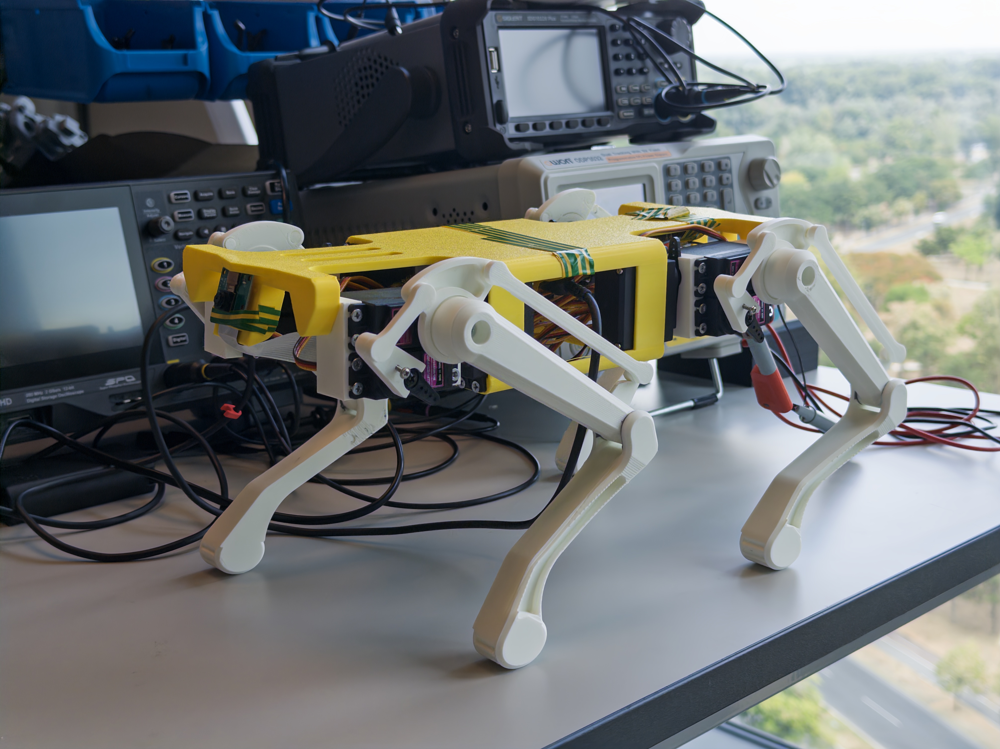

# Design, Fabrication, and Control of a Low-Cost Quadruped Robot with Integrated Computer Vision
This is my bachalor thesis where I developed a quadruped robot.

## Literature overview
There are a couple of papers that influenced this project and showed the direction in which I should go.

1. 1968 Mathematical Biosciences article “On the stability properties of quadruped creeping gaits”: defines a requirement for a crawl gait - the projection of the center of gravity onto the ground must remain within the support polygon, which is formed by all feet in contact with the ground, it then defines the most stable crawl gait.
2. 1984 article “Experiments in Balance with a 3D One-Legged Hopping Machine”: dynamic locomotion; basically, moving the projection of the center of gravity outside support region causes the robot to start falling - catching yourself creates dynamic gait.
3. 2008 article “BigDog, the rough-terrain quadruped robot”: famous example of dynamic locomotion on rough terrains
4. 2016 article “You Only Look Once architecture”: original YOLO paper; divide image into a grid, each grid cell is responsible for predicting bounding boxes, confidence scores, and class probability

This is not the full list of the reviewed papers but the most important/influencial for this project.

## Problems and solutions

I identified 3 problems that I wanted to solve.

1. High cost
2. Close sourced
3. Hard to assemble/modify

In addition, I defined these requirement for the project.

1. The robot should be able to walk on flat surfaces in all directions
2. The robot should have 12 degrees of freedom (DOF)
3. It should have computer vision capabilities to detect objects
4. The robot should be easy to assemble and reproduce by others

## Model design

I decided to use OnShape for modeling. It is easy and free to use. In addition, it is web-based so you don't need to download an executable and you can model from different computers.

I decided not to create a model from scratch but rather find something close to what I want and shape it to the state I want.

The model contained dozens of parts and it was not satisfying my **ease of assembly** requirement. I decided to significantly reduce the number of parts by making the leg print-in-place. I redesigned all connections, which required crews, to not requiring them at all. No screws, no need to assemble - just print and it's ready. Empirically, I found out that the gap of 0.65 mm between parts was the perfect spot so most of the connections have this clearance. The print-in-place approach requires no overhangs and this is the case for most of the leg, but the motor extension and femur-to-tibia connection exempts from these rule since I found no solution to these types of connections.

The best combination for priting is using a Bambu H2D printer with PLA for the leg in one nozzel and PETG in the other for the support.

The leg underwent 20 or more iterations of design.

## Hardware

I used a Raspberry Pi 4B 4GB, PiCamera, PCA9685 driver and 12 MG006R servos.

## Software

The whole project is written in Python with Adafruit ServoKit, Ultralytics, Picamera2 libraries.

I split a step into two phases: swing and stance. For the swing phase, I set `x0` beginning, `x1` destination and `y` step height. The trajectory is a sampled sine. Stance is just returning to `x0` with unchanged `y`. To find the right hip and knee angles, I create a lookup table that maps hip and knee angles to x and y relative to the center of the hip servo motor. The algorithm finds four nearest points to the desired destination and interpolates based on the inversed distance weighting (Shepard's interpolation). It is repeated throught all samples.

This is much simpler than the inverse kinematics approach since the knee angle changes when the hip moves.

There is also an HTTP web server that serives a web interface to control the robot and video stream the image from the camera.

## Computer Vision

For this project I wanted the robot to detect humans and dogs (these are what the dogs are most interested in to interact with?). In addition, the camera heigh is 17 cm and there are no human and dog datasets that provide images from these angles. I trained YOLOv8 nano model on a custom dataset consisting of COCO and Satanford Dogs and their permutations (cropping the upper parts of the detecting objects, altering colors, rotating, translating, scaling and horizontal flipping). To improve detection, I added negative samples (have neither of the two classes).

The latest and most successful training had 60 epoches and took ~7 hours on M2 Pro with MPS device selected. After the training the checkpoint was converted to the NCNN format, which increased the FPS up to 3 times.

## Results

The robot can walk on flat surfaces in all directions, has 12 degrees of freedom, can detect humans and dogs, is easy to assemble and reproduce, and uses affordable components.

The total cost of the purchased components was 33,690 RSD.

Printing the body, four legs, and eight servo holders took approximately 20.5 hours and used 490 grams of filament. Based on the assembly process, the robot can be assembled in approximately one hour after the printed parts are prepared.

The total weight of the robot is 1,171 g.

The prototype was tested using a laboratory power supply set to 6 V with a 6 A current limit.

Implemented gaits: crawl, trot, turning, and sideways movement gaits.

The web interface provides robot controls with live video streaming and object detection.

The measured speed is 4.75 cm/s without the web server, 2 cm/s with video streaming, and 0.35 cm/s with video streaming and object detection.

## Links

* [Quadruped source code](https://github.com/RomanSannikov/quadruped)
* [Quadruped vision source code](https://github.com/RomanSannikov/quadrupedvision)